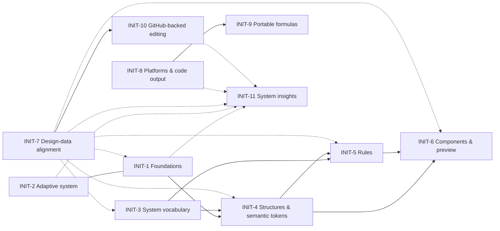

# Roadmap

High-level initiatives (`INIT-n`) and epics (`EPIC-n.m`) for this project. Agents read this before planning any feature (see "Roadmap alignment" in `AGENTS.md`). It describes direction, not implementation detail.

**Status legend:** `done` · `in progress` · `planned` · `long horizon` · `parked` (not yet defined)

## Purpose

An almost end-to-end **design system authoring experience** that eventually becomes the authoring UI for the `design-data` project and ships with its releases.

- Designers author **adaptive foundations** (color, typography, spacing, motion, …) as formulas with parameters, not as hand-picked values.
- Designers define **presets inside modes**. Chosen parameters are exposed as **end-user adaptive controls** (brightness, contrast, text size, spacing, …), so shipped products adapt the way the designer intended.
- Foundations produce **primitive tokens**. **Structures**, **option groups**, a shared **taxonomy**, and **rules** produce **semantic tokens** and variants.
- Everything combines into design data. A **preview app** built from authored **components** lets designers see and test changes live.
- Saving and review run through **GitHub**: branch → commits → PR against the design-data repo.

## Guiding principles

1. **One consistent system of terminology.** Terms, concepts, and methods are clear, repeatable, non-conflicting, and non-duplicative. New concepts reuse the taxonomy (INIT-3) rather than inventing parallel vocabulary.
2. **System-first design, with overrides.** Values come from formulas and rules. Manual overrides are always possible, visible, and revertible, unless the formula that produces a value locks that part (the pattern in the Color foundation and the changelog).
3. **One generation path.** Preview, tokens, and code export all read from the same generator. No drift.
4. **Dogfood.** Previews render the tool's own generated output.
5. **Can align with design-data.** Models must be mappable to the design-data spec (name object, `value` XOR `$ref`, mode sets, cascade), even where design-data is still changing. The end goal is a 1:1 match.
6. **Pure CSS for web output.** No runtime JS in the exported color library. Blend in linear light and hit contrast targets exactly.

## Dependency map

Near-term priority: **INIT-1 → INIT-3 (as a dependency) → INIT-4 → INIT-5**.

---

## INIT-1 Foundations — `in progress`

Formula-driven foundations. Each one generates primitive tokens, contributes terms to the taxonomy (INIT-3), and declares its adaptive parameters (INIT-2).

| Epic | Status | Intent | Touches |
|---|---|---|---|
| EPIC-1.1 Color | `done` | Contrast-adaptive scales, contrast tokens, surfaces, polarity compensation, pure-CSS export, evaluation | `src/features/color-system/`, `src/panels/foundations/FoundationsColorPanel.tsx` |
| EPIC-1.2 Typography | `in progress` | Type scale with user text zoom (spectrum-density parity: font size, body/heading/component line heights, paragraph/heading spacing, icon size), rem CSS export with `[data-text-zoom]` blocks, typography tokens. Component size lives here temporarily; see EPIC-2.5 | `src/features/typography/`, `src/panels/foundations/FoundationsTypographyPanel.tsx` |
| EPIC-1.3 Spacing | `in progress` | Spacing scales generated from a scale type from the Logic library, with shared rounding rules (EPIC-5.1) and optional adaptive bindings (EPIC-2.3). Built on the shared dimension-scale engine (EPIC-1.9) | `src/features/spacing/`, `src/panels/foundations/FoundationsSpacingPanel.tsx`, `src/views/spacing/` |
| EPIC-1.4 Size | `in progress` | Component/element sizing scale on the shared dimension-scale engine (EPIC-1.9): default Global scale, tokens, change log, impact, edit session. Component size (t-shirt) rules remain EPIC-5.1 / EPIC-2.5 | `src/features/size/`, `src/panels/foundations/FoundationsSizePanel.tsx`, `src/views/size/` |
| EPIC-1.5 Radius | `planned` | Corner radius scale | same |
| EPIC-1.6 Elevation | `planned` | Elevation/shadow scale | same |
| EPIC-1.7 Motion | `planned` | Duration/easing scale | same |
| EPIC-1.8 Future foundations | `parked` | The foundation list is open; add new ones as they come up | — |
| EPIC-1.9 Formulas, interpolations & dimension scales | `in progress` | One bank of reusable **formulas** (a formula type such as Geometric, Linear or a custom expression, plus its parameters, a default base, and per-part *Allow override* and *Adaptive* flags; e.g. Type scale, Spacing) and **interpolations** (named shapes such as line-height blends), authored on the Formulas tab of the Logic page and shared by typography, spacing and size. A formula never defines steps: each foundation sets its own range, and may override only the parts the formula allows. A spacing, size or color scale holds its own steps, optional overrides, and bindings; the library does not. Remaining: edit interpolations in the focused editor instead of a dialog, and adopt the engine in radius, elevation and motion | `src/features/scales/`, `src/features/logic/`, `src/pages/logic/`, `src/panels/logic/`, `src/views/logic/` |

## INIT-2 Adaptive system — `in progress` (cross-cutting)

Modes, presets, and parameters exposed as end-user controls. Every foundation plugs into this.

| Epic | Status | Intent | Touches |
|---|---|---|---|
| EPIC-2.1 Mode sets & presets | `done` | Mode sets whose modes override foundation parameters | `src/features/modes/` |
| EPIC-2.2 Adaptive claims & controls | `done` | A mode set claims parameters as user-adjustable; TopBar adaptive controls popover | `src/features/modes/adaptive.ts`, `src/components/AdaptiveControlsMenu.tsx` |
| EPIC-2.3 Parameter registry for all foundations | `in progress` | Generalize `FOUNDATION_PARAMETERS` beyond color. Scale parameters (base value, ratio, and similar) can be bound to a mode parameter through explicit bindings, with the bindable parameters and neutral values in `BINDABLE_PARAMETER_RANGES`; typography ratio follows text zoom this way. Typography text zoom is registered, with per-foundation overrides, resolver, and the default "Accessible text scaling" mode set. Remaining: other foundations, and replacing the Color scheme fallback in `responsibleParameterIds` with a real ownership rule | `src/features/modes/parameters.ts` |
| EPIC-2.4 End-user runtime contract | `planned` | Define what engineering ships so user adjustments behave as the designer intended, on every platform | INIT-8, INIT-9 |
| EPIC-2.5 Product preset defaults | `planned` | Per-product defaults that sit between modes and themes: default color scheme (e.g. dark instead of light), default contrast, default component size. Component size currently lives in typography (EPIC-1.2) and must move here. Depends on and feeds EPIC-5.1 t-shirt size rules | `src/features/typography/model.ts` (`componentSize`), `src/features/modes/` |

Terminology: **modes** are in-app options users switch between (presets) or adjust fluidly (adaptive controls). **Themes** are ecosystem-wide visual language (parked). **Product preset defaults** (EPIC-2.5) are what a product chooses as its starting point within modes and size, without changing the visual language.

## INIT-3 System vocabulary — `planned`

The single source of terminology for the whole app.

| Epic | Status | Intent |
|---|---|---|
| EPIC-3.1 Taxonomy section | `planned` | Author taxonomy categories and terms, seeded with sensible defaults (e.g. property: color, width, gap, padding) |
| EPIC-3.2 Foundation-contributed terms | `planned` | Foundations register terms automatically (e.g. a new color scale's name joins the "color name" category) |
| EPIC-3.3 Term integrity | `planned` | Enforce unique, non-conflicting, non-duplicative terms across the app |
| EPIC-3.4 Option groups section | `planned` | Component options and variant groups are **one concept**: named groups of options (e.g. Size {S, M, L}, Shape {uniform, pill}), defined once and applied to structures and components. Likely syncs with design-data |

## INIT-4 Structures & semantic tokens — `planned` (depends on INIT-3)

| Epic | Status | Intent |
|---|---|---|
| EPIC-4.1 Structure model | `planned` | Basic, abstract, compositional interfaces reused as scaffolding for any component. Broader than design-data's `structure`/`substructure` name fields |
| EPIC-4.2 Semantic token model | `planned` | Semantic tokens alias primitives (`$ref`) and carry taxonomy terms and option-group values |
| EPIC-4.3 Structures section | `planned` | Author structures, assign taxonomy terms, and attach option groups |
| EPIC-4.4 Semantic layer in Tokens | `planned` | Tokens section shows and edits semantic tokens next to primitives |

## INIT-5 Rules — `planned` (depends on INIT-3, INIT-4)

System-level derivations that generate semantic tokens and structure variants.

| Epic | Status | Intent |
|---|---|---|
| EPIC-5.1 Rule model | `in progress` | Reusable rules referenced by id, authored on the **Logic** page (code in `features/logic`), which also hosts the formula and interpolation libraries on its Formulas tab (EPIC-1.9); rules live on its Rules tab. First type: rounding (depth + default factor + ordered conditions, first match wins; factor 0 = no rounding), used by typography, spacing and size. Next: option → relative steps along foundation scales (e.g. small = font size −1, padding −1, gap −1). T-shirt size rules must build on the product component size (EPIC-2.5), which shifts the same scale index as text zoom |
| EPIC-5.2 State rules | `planned` | e.g. `state: hover` = color +1 |
| EPIC-5.3 Rule engine | `planned` | Generate semantic tokens and structure variants from rules, kept in sync with foundations |
| EPIC-5.4 Overrides | `planned` | Per-token overrides of rule output, same pattern as Color |
| EPIC-5.5 Design-data spec proposal | `planned` | Propose rules as a design-data spec extension so the data carries its own derivations |

## INIT-6 Components & preview — `planned` (depends on INIT-4; INIT-5 for variants)

| Epic | Status | Intent |
|---|---|---|
| EPIC-6.1 Visual anatomy editor | `planned` | Compose components from structures (predefined, or an empty element that must be named in the component's context). Visual, not a JSON table |
| EPIC-6.2 Component–token relationships | `planned` | Bind anatomy parts to semantic tokens. Slice built: component impact, the share of all component assignments whose effective value changed (`src/features/impact/componentImpact.ts`) |
| EPIC-6.3 Lightweight interactivity | `planned` | Minimal mouse/keyboard behavior for previewing states |
| EPIC-6.4 Sample app from components | `planned` | Build the preview app (currently `src/views/SampleApp.tsx`, S2-based) from authored components |
| EPIC-6.5 Multiple product screens | `planned` | Several preview screens the user can switch between |

## INIT-7 Design-data alignment — `in progress` (cross-cutting, ongoing)

| Epic | Status | Intent |
|---|---|---|
| EPIC-7.1 Mappable models | `in progress` | Keep every model mappable to design-data: name object, `value` XOR `$ref`, mode sets / values by mode, Foundation → Platform → Product cascade |
| EPIC-7.2 Export / import | `planned` | Read and write design-data format |
| EPIC-7.3 Spec validation | `planned` | Validate output against design-data SPEC rules |
| EPIC-7.4 1:1 convergence | `long horizon` | Become the design-data authoring UI once its registry is restructured |

## INIT-8 Platforms & code output — `planned`

| Epic | Status | Intent | Touches |
|---|---|---|---|
| EPIC-8.1 Platforms registry | `planned` | Register platforms that have, or will have, design-data extensions. **Needs research** into design-data platform manifests | `src/features/platforms/`, `src/pages/Platforms.tsx` |
| EPIC-8.2 Output per platform | `planned` | Code views show output for each registered platform type: `CSS` → pure-CSS library; `JS` → the generator functions used internally | foundation Code views |
| EPIC-8.3 Tokens code view | `planned` | Replace the "Coming soon" Code view in Tokens | `src/pages/Tokens.tsx` |

## INIT-9 Portable formulas — `long horizon`

| Epic | Status | Intent |
|---|---|---|
| EPIC-9.1 Formula abstraction | `long horizon` | Describe foundation formulas/functions without depending on a platform, so new platforms can reimplement them. Formulas and interpolations (EPIC-1.9) are already declarative expressions with parameters, a head start for this |
| EPIC-9.2 Spec proposal | `long horizon` | Possible design-data spec addition |

## INIT-10 GitHub-backed editing & distribution — `planned`

The edit-mode UI shell (Edit, Cancel, Save, Submit for review, changelog) is done. The backend is not.

| Epic | Status | Intent | Touches |
|---|---|---|---|
| EPIC-10.1 Auth & access | `planned` | Only users with repo edit access can edit | — |
| EPIC-10.2 Branch sessions | `planned` | Select or create a branch on Edit (replaces `BRANCH_NAME` placeholder) | `src/state/view/editMode.ts`, `src/features/edit-session/` |
| EPIC-10.3 Save = commit | `planned` | User-written message plus detail the UI adds from the changelog | `src/features/changelog/` |
| EPIC-10.4 Submit = PR | `planned` | Commit unsaved work, then open a PR to main that meets design-data standards (PR template, changeset, conventional commits, CI) | — |
| EPIC-10.5 Ship with design-data | `long horizon` | Bundle the app with design-data releases | — |

## INIT-11 System insights (Home) — `in progress`

A single integrated dashboard (not split by persona) for designers, engineers, systems designers, and leadership. It reads Score → Action → Evidence, and five health pillars (systematicity, accessibility, platform consistency, adaptivity, spec conformance) tie each action and evidence module back to the summary.

| Epic | Status | Intent | Touches |
|---|---|---|---|
| EPIC-11.1 Dashboard with sample data | `in progress` | Health summary, needs-attention queue, platform divergence, derived vs overridden, accessibility across modes, foundation coverage. Typed sample data only | `src/features/insights/`, `src/views/home/` |
| EPIC-11.2 Metric definitions | `planned` | Exact formula for each pillar; definitions of "stale override" and "divergence" (share overridden vs size of the override); trend baseline (last release vs last save) | `src/features/insights/model.ts` |
| EPIC-11.3 Live data wiring | `planned` | Replace `systemInsightsAtom` sample data with selectors, one initiative at a time (depends on INIT-1, INIT-2, INIT-7, INIT-8, INIT-10) | `src/features/insights/state.ts` |

Cross-domain planning gate: Every new editable foundation, token, mode, or feature type should assess change-log source detection, system-wide token-concept and mode-value denominators, generated/manual classification, revert behavior, and browser coverage. The Changes overview compares working data, including unsaved edits across declared modes, against app-shipped defaults and excludes temporary previews; it does not replace EPIC-11.2 metric definitions or EPIC-11.3 Home insights wiring.

## Parked

- **Themes** — a future idea, not yet defined in design-data. `src/pages/Themes.tsx` is a stub.
- **Settings** — placeholder for system-wide settings; may be unnecessary if other sections cover it. `src/pages/Settings.tsx` is a stub.

## Open decisions

| Topic | Current direction |
|---|---|
| Taxonomy source of truth | Owned by the app for now, because the design-data registry is being restructured. It must stay alignable, and 1:1 is the end goal (EPIC-7.4) |
| Structures vs design-data `structure` | Related but broader. The mapping (one structure → `structure` + `substructure`/`anatomy` fields?) is undecided |
| Rules in design-data | Propose as a spec extension (EPIC-5.5) |
| Foundation set | Open; currently spacing, size, radius, elevation, motion |
| Platforms model | Needs research into design-data platform manifests and extensions |
| Non-web code output | Undecided; see INIT-9 |
| Themes, Settings | Undefined |
| Product preset defaults | Component size stays in typography until EPIC-2.5 defines where product defaults live (mode-default overrides vs a separate layer) |
| Spacing and text size | Decided: spacing and size are independent of text size by default. A scale may follow a mode parameter, or derive from another scale, only through an explicit binding or curve authored on the scale (EPIC-1.9, EPIC-2.3) |
| Spacing rounding steps | Decided: rounding is a rule referenced by id on each spacing, size and typography scale (EPIC-5.1). The fixed rounding steps of the original spacing formula are the default rounding rule |
| Formula and interpolation vocabulary | **Formula** is a named, reusable definition on the Logic page: a **formula type** (Geometric, Linear, Custom expression) chosen when it is created, its parameters, a default base, and for each part an *Allow override* flag (a foundation may set its own value) and an *Adaptive* flag (a foundation may bind it to a mode parameter). A locked adaptive part keeps the formula value at the neutral position. Steps (the range of values) belong to the foundation, never the formula. Code keeps `ScaleType`/`scaleTypeId` to avoid colliding with spacing, size and color scales. **Interpolation** is a reusable named shape (method or custom expression) and replaces "curve"; `InterpolationMethod` and bindings are unchanged. **Binding** is the link from a part to a mode parameter. **Logic** is the page that holds formulas, interpolations and rounding rules. Whether these become design-data terms is open (EPIC-9.2) |
| Spacing scale names in the taxonomy | Scale names must become taxonomy terms (EPIC-3.2), but their category and placement are undecided |
